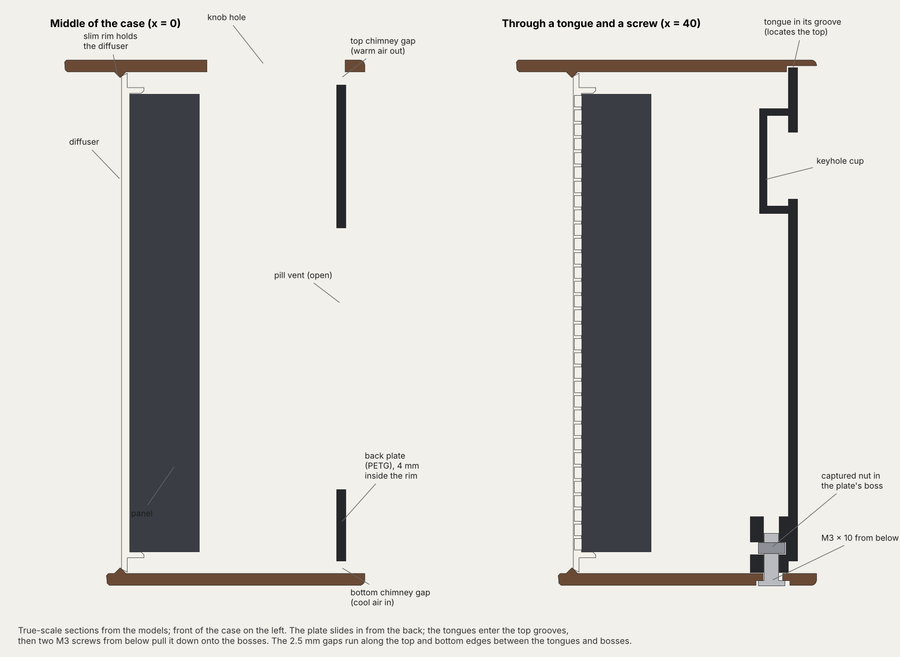

# CTA LED Board: Bar Sleeve Case (v4, Oct 26, 2026)

Walnut wood PLA sleeve with a slanted shade hood, white (or translucent grey) diffuser with a fused grid, black PETG back plate that carries the Matrix Portal S3. Printed back-down (layer lines square to the case), with the screen rim built in and every opening printed open. Future builds may use other colors of PLA. Full design history: [DESIGN-HISTORY.md](DESIGN-HISTORY.md).

## Fixed decisions
- Slanted hood (12 mm lip at the top, 3 mm at the bottom): non-negotiable.
- Shell in Bambu PLA Wood (walnut), printed back-down, front lapped flat afterwards (the sloped front prints as a fine staircase). The screen rim is part of the shell: two 45° slopes, no supports, no glued frame.
- Openings print open: knob hole, USB-C and the four screw holes. The light-sensor hole is optional: a blind Ø2 pocket inside the top marks it (nothing shows outside); drill through only if you fit the sensor. They cause small bands in wood PLA; the cut-out skins and glued frame tried before banded too, so the simpler build won.
- No grilles in the shell. The back plate (v3) is a tray that fills the bore, with one louver band along its bottom (inlet) and one along its top (outlet), slots in a regular symmetric pattern rising 45° inward, so nothing inside shows from eye level or above. Typical draw ~2-5 W; check with the S3's chip-temperature log.
- The S3 mounts on the back plate, so its USB-C, status-light tube and Boot tube line up by construction. USB-C opening sized for the largest spec plug housing (13.65 x 8.0 with a 0.5 mm chamfer), so any compliant cable seats.

## Build set (`stl/`)
| Part | File | Material | Print |
|---|---|---|---|
| Shell | `bar-shell-v4-walnut-backdown.stl` (69 mm deep) | PLA Wood, 0.4 nozzle | as exported (back rim down), no supports |
| Wall spacers (wall hanging only) | `bar-wall-spacer.stl` (print 2) | black PETG | flat, 100% infill |
| Latch coupons (optional) | `coupon-v4-latch-shell.stl` (walnut) + `coupon-v4-latch-plate.stl` (PETG) | as the parts | as exported: slide the plate corner into the shell corner; it should click and need a firm pull to release |
| Standoff funnel coupon (optional) | `coupon-v4-standoff-funnel.stl` | as the plate | as exported: drop an M3 x 8 countersunk down the tube and check it finds the hole and seats |
| Diffuser | Two parts, loaded as one object: `bar-diffuser-white-face.stl` + `bar-diffuser-white-grid-black.stl` (0.2 face: 0.2 first layer, 0.4 nozzle), or `bar-diffuser-translucent-face.stl` + `bar-diffuser-translucent-grid-black.stl` (0.4 face: one 0.4 first layer, 0.6 nozzle) | face: white or translucent; the rest: black PETG | face down; the face part is the first layer |
| Back plate | `bar-backplate-v3.stl` (one piece) | PETG, one opaque color (black hides the insides best) | outer face down |
| Insert check (print first) | `check-panel-insert-template.stl` | any PLA | as exported; that face goes on the panel |
| Encoder collar | `bar-encoder-collar-backdown.stl` (0.4 mm clearance); `bar-encoder-collar-fit-set.stl` has 0.3 / 0.4 / 0.5 (1 / 2 / 3 notches) if unsure | walnut, or translucent PETG for the glow | flange-top down |
| Knob | `bar-knob-fit-set.stl` (three bore sizes, marked 1-3 dots under the skirt), then `bar-knob.stl` (the middle size) or the winner. Pebble, Ø30 x 12.7, grip flutes round the side, rounded shoulder, domed top | white PLA, or any | as exported (upright, skirt on the bed), no supports |
| Boot key | `bar-boot-key.stl` | PETG or PLA | flat |
| Sensor bracket (optional) | `bar-sensor-bracket.stl` (VEML7700 under the Ø2 hole, hung from the encoder board) | PETG or PLA | as exported, flat side down |
| Tilt plinth (optional) | `bar-plinth-walnut-8deg.stl` | PLA Wood | flat |
| Coupons | `coupon-v4-plate-boss.stl`, `coupon-v4-s3-pilots.stl` | as the parts | as exported |
- Optional light sensor: Adafruit VEML7700 (4162, flat), 10 cm STEMMA QT cable, 2 x M2.5 x 8 + 2 M2.5 nuts, 2-4 x M2.5 x 6. Firmware support (brightness from the sensor) is a separate change.
- Hardware: 4 x M3 x 10 + 4 M3 nuts (plate to shell, from below), 4 x M3 x 8 countersunk (plate to the panel's inserts, no washers; the tube floors are 90° funnels that guide the screw into the hole and seat the head), 4 x M2.5 x 8 (S3 to plate posts, self-tapping into a Ø2.4 pilot), the encoder's M7 nut, 4 x round black bumpers, 0.5 in x 0.15 in (12.7 x 3.8 mm; 3M SJ5312 size, e.g. Bumper Specialties BS01) (+4 for the plinth, +2 for the wall spacers), 1-2 hook-and-loop cable ties ~12 mm wide (power-cable bundle). Wall (optional): 2 pan-head screws (#6, #8 or M4; head up to ~7.6 mm across, ~4 mm tall) 80 mm apart, set so the head's underside stands 8 mm off the wall (4 mm rim recess + 2 mm plate + 2 mm gap); the keyholes have 6 mm of travel. 2 printed wall spacers (`bar-wall-spacer.stl`, Ø13 x 2.2) CA-glued flat inside the two circle outlines at the bottom of the plate's outer face, each with a round 0.5 in x 0.15 in bumper (12.7 x 3.8 mm, same as the feet) on top: the case then hangs 2 mm off the wall all round, so air comes in along the bottom of the rim and leaves along the top (with the rim flat on the wall the louvers are sealed). Metric hex keys: 1.5 mm (M2.5) and 2 mm (M3; its long arm must reach ~34 mm down the standoff tubes).
- Alternate (`stl/alternate-frontdown/`): the same shell printed front-down (front rim flat on the bed, no lapping; layer lines lean 4.7°) with its collar. `case2.py` can still make the skinned shell, glued frame, glue guide, drill guide and USB-C bezel (`GLUED_FRAME`, `SKINS`).
- For a shell already printed with skins over the openings (back-down v4, 69 mm): `stl/skinned-shell-parts/` has the glued screen frame in two clearances, `-cl30` and `-cl45` (0.30 / 0.45 mm per side; the original 0.15 bowed in a printed shell), black PETG or walnut, front face down, its glue guide (any PLA) and the USB-C bezel (flange face down). Cut the skins out, then glue the frame as in the earlier build: shell back-down on a flat table, guide inside, frame on the guide, small gel-CA dots on the frame's outer edge.

## Print settings
- Shell:
  - Bambu PLA Wood profile; filament dried (~8 h at 50-55 °C) and flow-calibrated.
  - 0.2 mm layers throughout (no variable layer height), 3 walls, elephant foot 0.15.
  - Seam: rotate Z 225° (or 135°) so the bottom-right corner faces the back of the plate, then Seam position "Back" and scarf seam; check in Preview.
  - Outer brim 5 mm with a 0.1 mm gap; Z hop 0.6 mm.
  - Plate washed with dish soap, then glue stick; bed 55-60 °C; door closed; no supports.
- Back plate (PETG): 0.24 mm layers, 4 walls, 4 top + 4 bottom layers, 15% infill (gyroid), monotonic bottom surface, textured PEI, elephant foot 0.15, Z hop, dried PETG; Bambu PETG profile. Not solid: bolted to the panel, it doesn't need it, and solid adds most of the print time.
- Collar in translucent PETG: 100% infill. Small parts (key, spacers): print beside a larger part.

## Finishing the shell
1. Clean up the openings: deburr the knob hole, USB-C opening and screw holes.
   - Optional light sensor: from inside, before anything is fitted, put a 2 mm (or 5/64") bit in the pocket under the top (55 mm right of the knob hole, seen from the front) and drill through the last 0.8 mm. Slowly, with a sharp bit; tape over the outside spot first so the exit stays clean, then deburr it lightly.
2. Lap the front flat on 220, then 400, paper taped to glass, in figure-eights. Deburr the edges.
3. Scrape the seam, sand along it with a flexible pad, and feather.
4. Scuff the outside evenly (grey Scotch-Brite or 400 wet), then finish with Danish oil or wax. Mask the bore, knob hole, USB-C opening, tongue grooves and foot recesses first. Lay oily rags flat to dry.

## Assembly
The panel can't slide past a mounted encoder (its top edge is ~4 mm above the encoder board's underside), so the panel goes in first and everything behind it is fitted from the open back.
1. Bench: collar into the knob hole; bumpers into the recesses. Push an M3 nut into each of the plate's four bottom-boss slots (it snaps past the narrowed mouth). S3 onto the plate's posts with 4 x M2.5 x 8.
2. Bench, optional light sensor: VEML7700 onto the bracket's carrier with 2-4 x M2.5 x 6 (chip up, chip edge toward the back). Bracket up against the underside of the encoder board's two right-hand corner holes (seen from the front), 2 x M2.5 x 8 up through both, nuts on top. 10 cm STEMMA QT cable from the encoder's right-hand socket to the sensor.
3. Snap the diffuser onto the panel. Case face down on a towel; panel and diffuser in from the back until the diffuser seats on the frame.
4. Encoder (with the sensor bracket) in from the back: shaft first, up into the collar, NeoPixel toward the front, the sensor under its hole. Clamp it with its M7 nut (and washer) from the top. Push the knob on until it stops on the shaft tip.
5. Cables, with the plate held just behind the case: ribbon from the S3's IDC to the panel's PI IN, clipped into the plate's hooks; panel power to the S3's terminals; encoder STEMMA QT cable (its left-hand socket) to the S3.
   - Power cable: fold the extra back and forth in ~3.5 cm lengths with the spare plug and wrap one hook-and-loop tie round it. Set the bundle wherever it fits behind the panel; if it shifts, thread the tie through the plate's tie loop (middle, above the ribbon; 16 mm opening for a 12-14 mm tie).
6. Plate in, tongues into the top grooves; it gets stiffer for the last few mm and clicks as the tongue bumps drop into their dimples. 4 x M3 x 8 countersunk down the standoff tubes into the panel's inserts (2 mm hex key), then 4 x M3 x 10 from below; the boss slots take up any depth error.
7. Plug in USB-C. (The status light shows through a plain Ø2 hole in the plate; a translucent rod didn't carry the light.)
- To flash: hold the Boot key in through the plate, plug in USB-C, upload, then replug. OTA updates are a later firmware job.
- To service: unplug USB-C; take out the four screws from below and the four in the standoff tubes; ease the plate out (the S3 comes with it, still cabled). To get the panel out, take off the encoder's top nut and lift the encoder out first.

## Key geometry (case frame: x right seen from the front, y back from the top front edge, z up from the bottom)
- Outer 217 x 110.3 x 69 mm (v4; 63 before); wall 2.5; corners R14; panel bore 212 x 105.3.
- Diffuser face at y 12; panel back at y 28.2; back plate y 63-65 (4 mm inside the rim). Screws from below at x ±40 and ±52, y 59.5. Top snap: a 0.7 mm bump on each tongue, a 0.5 mm dimple in each groove roof (0.7 mm of wall left over it).
- Panel inserts used by the v3 standoffs (case x, z from ZC): (-88, +31), (+88, +31), (+88, -26), (+7, -36), photo estimates ±1 mm, panel in normal orientation (PI IN on the right seen from the front). The fourth corner insert sits under the S3. Check with the template before printing the plate; correct `STANDOFFS` in `plate3.py` if needed.
- S3 from Adafruit's board file, component side facing the plate, board edge 2 mm inside the left wall (x -104):
  - USB-C at z = ZC (55.15), y 40.9; Down/Up/Reset at ZC -10.3 / -20.1 / -29.9.
  - Status LED at (-91.8, ZC-32.8); Boot at (-89.4, ZC-20.3); M2.5 holes at x -96.38 / -55.74, z ZC-7.62 / ZC-27.31.
- Knob hole Ø24 teardrop (tip to the front) at x 0, y 41.9; light-sensor hole Ø2 at x +55, y 42 (blind pocket from inside, 0.8 mm short; drilled through if used).
- Firmware: PR #431 logs the chip temperature once a minute (optional now).

## CAD sources (`src/`)
Parametric Python (manifold3d + trimesh); every STL in `stl/` is generated from these.

| Script | Makes |
|---|---|
| `panel.py` | Panel profiles (`PANEL=p3` default, `PANEL=p25`): outline, thickness, LED pitch and diffuser rib, panel inserts and plate standoffs, ribbon hooks, tie-down bridge. Everything panel-sized derives from it |
| `case.py` | Shared parameters and helpers (v1 shell and plate, kept as the base) |
| `case2.py` | Shell v4 back-down (main) and front-down (alternate), both with the built-in rim and open holes; Boot key; the older skinned shell, glued frame, glue guide, drill guide and USB-C bezel behind flags |
| `drawer.py` | v5 drawer: the tray and the v5 shell (USB-C on the right, no tongue grooves), fit coupons |
| `cleat.py` | v5 French cleat: case cleat (bolts to the tray) and wall cleat |
| `plate3.py` | Back plate v3 (bolted to the panel, corner foot under the S3), insert template, wall spacer, coupons |
| `sensor.py` | Light-sensor bracket: `python3 sensor.py <outdir>` |
| `knob.py` | Knob and its three-size fit set: `python3 knob.py <outdir>` |
| `collar.py` | Encoder collars for both shells |
| `diffuser.py` | Diffuser: `python3 diffuser.py <outdir>/` writes the two-colour sets; `python3 diffuser.py <out.stl> [face thickness]` one piece. The 0.4 face makes the stack 0.2 mm thicker; the plate's snap and screw slots take it up |
| `plinth.py` | Tilt plinth: `python3 plinth.py <outdir> [degrees]` |
| `layerscan.py` | Slices a print-oriented STL in 0.2 mm layers and reports separate pieces and path length per layer (the banding check) |

```bash
cd hardware/bar-sleeve-case/src
pip install -r ../requirements.txt
python3 case2.py ../stl          # back-down shell and Boot key; front-down shell into ../stl/alternate-frontdown/
python3 plate3.py ../stl         # v3 plate, insert template, wall spacer, coupons
python3 sensor.py ../stl         # light-sensor bracket
python3 knob.py ../stl           # knob + fit set
python3 collar.py ../stl
python3 diffuser.py ../stl/        # two-colour sets (white 0.2 and translucent 0.4 face + black rest); <file>.stl [face] = one piece
python3 plinth.py ../stl 8
python3 layerscan.py ../stl/bar-shell-v4-walnut-backdown.stl /tmp/scan.npy
```

### v5 drawer (in testing)
`src/drawer.py` -> `stl/v5-drawer/` (P3; `PANEL=p25` for the P2.5). The flat back plate becomes a rigid tray that slides into the
sleeve from the back: four walls 2.5 mm thick, 0.25 mm inside the bore, running forward to the diffuser's flange. A deep tray in a
snug sleeve can't tilt, so the top needs no tabs or latches; the two screws from below stop it sliding out. The sleeve keeps its
look; only the USB-C opening moves (low on the right) and the tongue grooves go.

- Stiffness: the sleeve's walls are 3.5 mm (v4 2.5; `CASE_WALL` sets it) and the tray's 2.5. Bending stiffness goes with wall
  thickness cubed, so ~2.7x and ~2x. Crush ribs on the tray's outside (0.35 mm tall, 0.1 mm into the sleeve, ramped at the leading end) take up the clearance so the two walls brace
  each other instead of sliding. The encoder collar follows the thicker wall (`bar-encoder-collar-v5.stl`).

- The panel sits turned 180° (input header on the left): set `MATRIX_ROTATION 180` in `secrets.h`. The S3 is turned 180° too,
  on the right, centred between the panel's right-hand posts, so all four corner inserts get a bolted post (funnel tubes).
- Top wall: one slot open to the front edge, only as wide as the knob encoder's body (18.7 mm). The light sensor rides on the
  tray: screwed under the top wall (4 x M2.5 x 6 into the pillars, chip up) below a Ø4 hole lined up with the sleeve's Ø2
  light hole; no bracket. Right wall: a slot for the USB-C plug and
  the S3's edge buttons. Back: full-width louver bands, Boot and status-light holes, one pair of ribbon hooks, a tie loop, two
  nut bosses for the French cleat. No keyholes.
- Order: diffuser and panel into the sleeve; encoder from the back; S3 and sensor onto the tray; tray in;
  4 x M3 x 8 countersunk down the post tubes into the panel; 2 x M3 x 10 + nuts from below (one pair, x +/-46, both panels).
- Print `coupon-v5-drawer-fit-shell.stl` (walnut) and `coupon-v5-drawer-fit-tray.stl` (tray filament) first and slide them
  together: the ribs should press in with firm hand force, no wobble. Change `CR_H` (rib height) or `TRAY_CL` in `drawer.py` if not.
- Print: shell back-down as v4; tray back face down, walls up, no supports.
- Wall mount (`src/cleat.py` -> `bar-cleat-case.stl`, `bar-cleat-wall.stl`): a French cleat, both pieces 12 mm deep. The case
  cleat bolts to the tray's back between the louver bands (2 x M3 x 10 from the wall side, nuts dropped into the bosses inside
  the tray before the S3 goes in). The wall cleat takes 2 x #8 / 4 mm countersunk screws (or anchors); its face holds the tray
  back, so the case hangs plumb with no bottom spacer. The rim sits 8 mm off the wall, both louver bands open. To hang: lift
  ~12 mm above the resting spot, push to the wall, drop onto the bevel. Print both wall face down, no supports, PETG.

### Other panels
Set `PANEL` to build for another profile; with no `PANEL` the P3 STLs are unchanged.

```bash
PANEL=p25 python3 case2.py ../stl-p25   # and the same for every other script above
```

- **P2.5** (Waveshare RGB-Matrix-P2.5-64x32, 160 x 80): case 185 x 94.3 x 78 (9 mm deeper than P3, see PO OUT below). Same S3, knob, USB-C and screws. Panel back (listing photo, scaled to the outline, ±1 mm): six M3 inserts on the top and bottom rails at x ±63.5, z ±33.5 plus (-12.9, +33.5) and (+12.9, -33.5); PI IN at x +40, PO OUT at x -40, both z ≈ -1; power socket near the centre. The plate bolts to three corner inserts (no centre one) and takes one pair of screws from below (x ±46, 2 x M3 x 10 + nuts). Keyholes sit beside the top corner posts (x ±51.5, wall screws 103 mm apart), so each louver row is one run: top -45..45, bottom -35..35. The left ribbon hook moves to x -13.5; the tie loop sits 4 mm right of centre and lower. The optional light sensor moves to x 40 (at 55 its bracket hits the top-right standoff).
- **PO OUT vs the S3:** the header sits under the S3's unused bottom socket (they overlap ~0.5 mm in x). `s3_back` in the profile moves the S3 back from the panel and deepens the case by the same amount, so the ribbon keeps its 10.7 mm fold room behind the S3's plug. It's 9.0 now, the worst case (a 9 mm shroud on a PCB flush with the rails). Measure how far PO OUT stands above the brass insert faces and set `s3_back` to that: the case gets shallower by the difference.
- **Not measured yet:** P2.5 thickness (14.5 assumed), the photo positions, PO OUT's height above the insert faces (sets `s3_back`). Print `check-panel-insert-template.stl` from the P2.5 build on the real panel and correct `inserts` / `standoffs` in `panel.py` before printing the plate.
- P2.5 diffuser: print it on the 0.2 nozzle (each 0.45 mm rib is two of its lines; on a 0.4 nozzle the single-bead ribs printed wavy and uneven, even with classic walls). The face is 0.14 mm: set the profile's initial layer height to 0.14 (the most a 0.2 nozzle takes) so it stays one layer; a face thicker than the first layer slices as two layers and loses translucency.
- **P4** (256 x 128) has no profile: the case (~277 mm) and diffuser (~275 mm) exceed the X2D's 256 mm bed, so it needs split parts first (Enclosure Notes, "P4 approach").

`hardware/` is in `.dockerignore`, so none of this ships to Fly.


