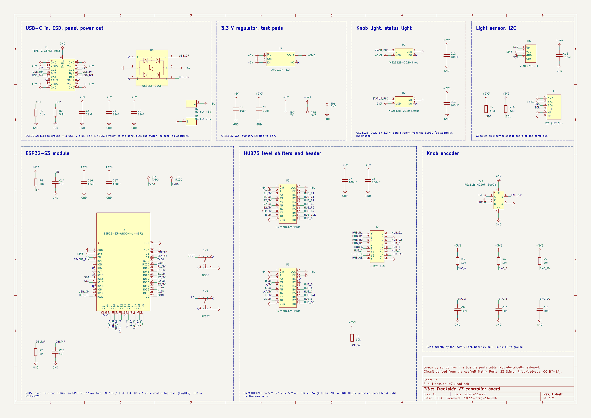
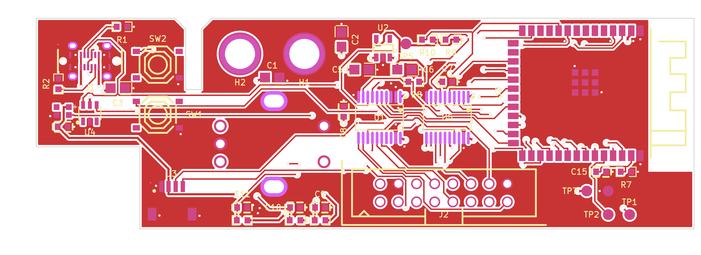
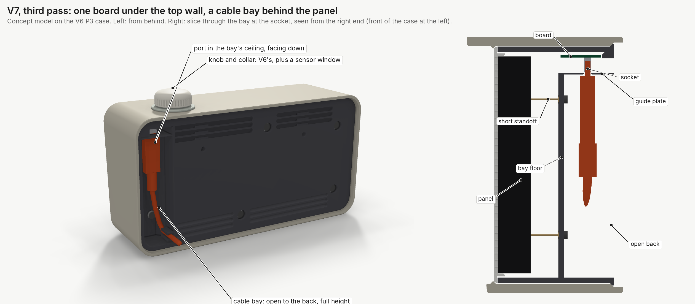
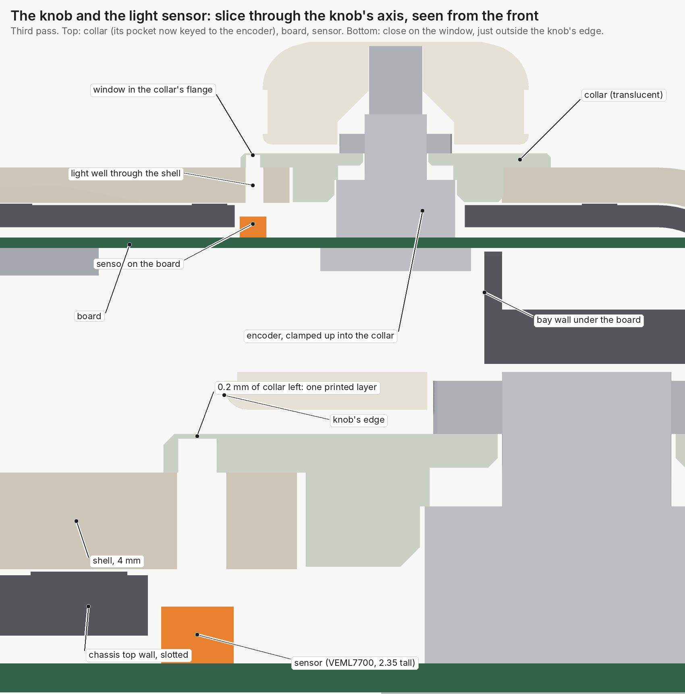
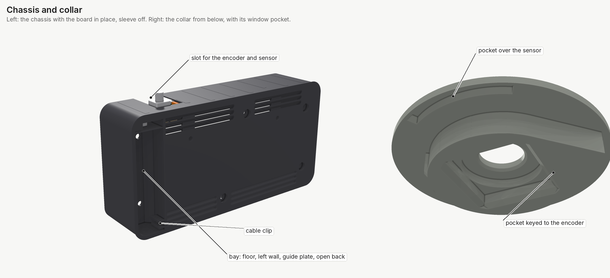

# Trackside V7: one custom board (a design, not built)

**V7 is a design on paper.** Nothing in this folder has been ordered, printed, assembled or tested, and no engineer has
reviewed the circuit board. The Trackside being built today is **V6** ([../bar-sleeve-case](../bar-sleeve-case/README.md)),
with bought boards inside; V6 is the pilot. V7 is what replaces V6's electronics if the pilot sells: the plan is to switch at
roughly 100 units.

## What V7 is

One circuit board in place of the three bought boards inside the case, and the changes to the case that follow from it.

| | V6 (the pilot) | V7 (this folder) |
|---|---|---|
| Controller | Adafruit Matrix Portal S3 | an ESP32-S3 module on our own board |
| Knob | Adafruit 5880 encoder board, read over I2C | the encoder soldered to the board, read directly |
| Light sensor | Adafruit VEML7700 board on a sled, under a pinhole | the VEML7700 on the board, under a thin window in the knob's collar |
| USB-C | in the end wall, plug in view | facing down inside a cable bay at the back, plug out of sight |
| Boards to wire together | three, with cables | one |
| Status | being built | drawn and quoted; not reviewed, not built |

What V7 does not change: the panel, the walnut sleeve and its slanted hood, the knob on top, what the firmware does.
The firmware's panel pins stay the same; it needs a new encoder driver (see [Firmware](#firmware-work-v7-needs)).

## How far it has got (Nov 27, 2026)

| Piece | State |
|---|---|
| Parts | Chosen. Each one checked for stock in JLCPCB's parts data. |
| Schematic | Drawn: [board/trackside-v7-schematic.pdf](board/trackside-v7-schematic.pdf). It matches the board pin for pin (47 nets). |
| Board | Placed and routed by machine on 4 layers. KiCad's design-rule check is clean. **No engineer has reviewed it.** |
| Price | Quoted at JLCPCB: $1,085.57 for 100 boards, assembled ($10.86 each). See [The quote](#the-quote). |
| Case | A 3D model with 28 fit checks, all passing. Its first pass had an independent review. Nothing printed. |
| Firmware | Not started. |







## Before anyone orders this

1. **An electrical engineer reviews the board**, and probably re-routes it by hand: the power path (the panel can draw 3 to
   4 A), the antenna's surroundings, ESD, decoupling, the USB data pair (routed here as two ordinary tracks).
2. Re-quote with the 4-layer file (the quote below was taken on an earlier 2-layer version).
3. Measure a real encoder. The case assumes its body is 6.5 mm tall; the board hangs from it.
4. Check the guide plate under the USB socket against a real plug and socket (it needs 1.05 mm; the drawings suggest 1.6).
5. Redraw the knob for the Bourns shaft (its tip sits about 1.6 mm lower than V6's knob expects).
6. Check the panel's power lead and lugs against the two M3 nuts.
7. Check part rotations in the placement file against JLCPCB's conventions, and the footprints against datasheets
   (both are JLCPCB's own, unchecked).
8. Test prints: the collar's sensor window, the board's capture in the chassis, the guide plate.
9. FCC position for a board sold under the Trackside name: not looked into.

## The board

- 92.0 x 29.5 mm, 1.2 mm thick, 4 layers: parts and signals on the two outer layers, an unbroken ground plane and an
  unbroken +5 V plane inside. A notch in the back edge and a cut-back corner fit the case.
- It hangs under the case's top wall from the knob's encoder. Most parts are on the underside. The side facing the case's
  top has only the encoder, the knob's light, the light sensor and five small parts, because there is 1.15 mm of room.
- The circuit is Adafruit's Matrix Portal S3 design (same module pins, level shifters and regulator) with these changes:
  - encoder read directly: A on GPIO 9, B on GPIO 10, switch on GPIO 11, each with a 10 k pull-up and 10 nF;
  - knob light (WS2812B-2020) on GPIO 12; status light on GPIO 4 as today, in the cable bay's ceiling;
  - VEML7700 on I2C (GPIO 16, 17), plus a 4-pin JST SH connector on the same bus that takes today's sensor board;
  - a vertical USB-C socket with ESD protection on the data lines;
  - left out: accelerometer, Up/Down buttons, analog light sensor, red LED, breakout header.
- 43 parts on 21 lines. The main ones: ESP32-S3-WROOM-1-N8R2, Bourns PEC11R-4220F-S0024 encoder, VEML7700-TT, two
  SN74AHCT245, AP2112K-3.3, a 16-pin ribbon header. LCSC numbers are in [board/bom-jlc.csv](board/bom-jlc.csv).
- Two parts are through-hole (the encoder and the ribbon header) and parts sit on both sides. Both raise the assembly price.

How it was made, plainly: the schematic and the board are generated by the scripts in `src/` from one parts table, and
the tracks were laid by an autorouter (Freerouting). That makes the files a quote needs and a sound starting point. It is
not a substitute for a person's layout.

## The case

V6's case with a new chassis. The model is [case/v7.py](case/v7.py), built on V6's (`../bar-sleeve-case/src/v6p3.py`).

- **Cable bay** at the right end, behind the panel, open to the back: the socket faces down into it, so the plug and the
  first bend of the cable are inside the case.
- **Guide plate** under the socket's mouth, with holes for the plug, the Boot and Reset buttons and the status light.
- **Sensor window:** a pocket in the translucent collar's flange leaves 0.2 mm (one printed layer) over the sensor, just
  outside the knob's edge.
- **The board is held without screws:** the encoder's nut clamps it to the collar, a keyed pocket sets its angle, and
  stops, crush ribs and a fin in the chassis take it when the chassis slides in. This is the part most likely to be
  simplified after a test print.
- The independent review of the first pass is [case/REVIEW-pass1.md](case/REVIEW-pass1.md). It found the concept sound and
  the first model impossible to assemble with real parts; those findings are fixed in the model here, and the fixes have
  not been reviewed again.

| | |
|---|---|
|  |  |

## The quote

JLCPCB, Nov 27, 2026: 100 boards, Standard assembly, both sides, taken on the earlier 2-layer version of this board.

| Line | $ |
|---|---|
| Bare boards (board 49.10, engineering 8.00, via covering 16.03, film 1.80, file check 1.05) | 75.98 |
| Components, 21 lines | 790.28 |
| Set-up 51.50, stencil 16.54 | 68.04 |
| Feeders 29.45, SMT assembly 35.22 | 64.67 |
| Manual assembly 37.95, hand-soldering 3.61, fixture 41.35 | 82.91 |
| Packaging 0.69, special components 3.00 | 3.69 |
| **Total** | **1,085.57** |

Shipping and import duty are not in it. Four layers will raise the first line. To quote again: upload
`board/trackside-v7-gerbers.zip`, set the thickness to 1.2 mm, turn on assembly (Standard, both sides), then upload
`board/bom-jlc.csv` and `board/cpl-jlc.csv`.

## Firmware work V7 needs

- Read the encoder on GPIO 9 (A), 10 (B), 11 (switch). The Bourns part gives 24 pulses and 24 detents per turn.
- Drive the knob's light directly on GPIO 12.
- Ignore the light sensor while the knob's light is on (the light reaches it).
- Retune the dark and bright levels: the sensor sees more light than under V6's pinhole.
- Unchanged: the HUB75 pin map, the TinyUF2 loader and double-tap reset, flashing over USB, I2C on GPIO 16/17.

## What is in this folder

| Path | What |
|---|---|
| `board/trackside-v7.kicad_pro` | The KiCad 7 project: schematic and board. Open this. |
| `board/trackside-v7-schematic.pdf`, `schematic.png` | The schematic, to read without KiCad. |
| `board/trackside-v7-gerbers.zip`, `bom-jlc.csv`, `cpl-jlc.csv` | The three files a JLCPCB quote takes. |
| `board/netlist.csv`, `placement.txt`, `drc.txt` | Every net and its pins; where each part sits in the case; KiCad's check report. |
| `board/jlc.pretty/`, `jlc.kicad_sym` | Footprints and symbols (JLCPCB's own, fetched through EasyEDA). The 3D models are not kept (39 MB); `easyeda2kicad` fetches them by LCSC number into `board/jlc.3dshapes/`. |
| `src/` | The scripts that make all of the above. |
| `case/` | The case model, its renders and the review of its first pass. |

## Making it again

Needs KiCad 7 (its `pcbnew` Python module and `kicad-cli`), Java, `xvfb-run`, and Freerouting 1.9.0 saved as
`src/tools/fr-1.9.0.jar` (not kept in the repo).

```
cd src
python3 build_all.py     # places the parts, routes, checks, exports. Repeats the router until nothing is unconnected.
python3 gen_sch.py       # draws the schematic from the same parts table
python3 check_sch.py     # compares the schematic's netlist with the board's
cd ../case
python3 v7.py            # the case model's 28 fit checks ("render" as an argument draws the pictures)
```

`gen_board.py` on its own writes an unrouted board over the routed one. The router's result differs from run to run, so a
rebuilt board will not match this one track for track. KiCad's check reports no violations with two library-bookkeeping
checks switched off in the project: the footprints were edited on the board (silkscreen trimmed off pads, part names
moved), so they no longer match their library copies.

## Licence

The circuit is derived from the Adafruit Matrix Portal S3 by Limor Fried/Ladyada for Adafruit Industries, published under
Creative Commons Attribution/Share-Alike. A board made from these files must credit Adafruit and be shared under the same
terms. The credit is on the board's silkscreen and in the schematic's title block.
